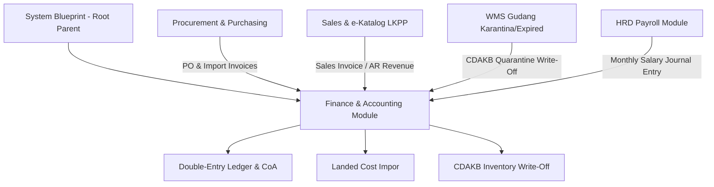

> **Status 25 November 2026: sebagian diimplementasikan.** Jurnal, CoA, posting/void dan kalkulator memiliki tes domain. Koleksi aplikasi memakai cache browser dan sinkronisasi state server; §2 adalah desain SQL target, bukan skema ledger runtime. Alur event-driven dan pembukuan otomatis lintas modul di bawah merupakan rancangan, bukan bukti operasional. Lihat [evaluasi staging](./evaluasi-staging.md).

# Blueprint - Finance & Accounting / F&A (Child)

Status: **Blueprint historis; implementasi dan integrasi parsial**

Parent Document: `/docs/system-blueprint.md` (Domain: Supporting System — Finance & Accounting)  
Sasaran Modul: `src/components/modules/supporting/FinanceModule.tsx` (beserta engine ledger double-entry, CoA, landed cost, dan CDABK write-off)  
Kerangka Regulasi: Standar Akuntansi Keuangan (SAK), CDAKB Permenkes RI 4/2014, ISO 13485:2016, Perpajakan RI (PPN 11%, PPh 22 Impor, e-Faktur), ALCOA+ Data Integrity.
Coded by Langgo Bramandityo

---

## 1. High-Level Enterprise Architecture & Integrasi Modul (target)
Modul Finance & Accounting (F&A) REMEDI dirancang sebagai pusat pencatatan keuangan enterprise dengan pendekatan *Event-Driven Architecture* (EDA) untuk menjaga konsistensi data real-time lintas modul:
- **Modul Produksi / Manufaktur (ISO 13485)** ──> *(COGM / HPP Engine)* ──┐
- **Modul Gudang / WMS (CDAKB Karantina)**    ──> *(Inventory Valuation)* ┼─> **[Modul Finance & Accounting]**
- **Modul Sales & Distribution (SDAK)**     ──> *(AR / Invoice Engine)* ┘
- **CDAKB & SDAK Gate:** Setiap penjualan hanya dapat ditagih (*Invoiced*) jika nomor batch produk valid, tidak masuk daftar recall, dan didistribusikan ke fasyankes berizin.
- **ISO 13485 Gate:** Biaya Quality Control (QC), *scrap material* gagal, dan kalibrasi mesin otomatis dialokasikan ke Cost of Goods Manufactured (COGM) atau Biaya Operasional (BOP) spesifik.

---

## 2. Database Schema Design (PostgreSQL Enterprise)
Desain skema basis data relasional dengan indeks optimal untuk menjamin *traceability* dari jurnal umum hingga ke nomor batch alkes spesifik:

```sql
-- 1. Chart of Accounts dengan segmentasi cost center
CREATE TABLE accounts (
    account_id SERIAL PRIMARY KEY,
    account_code VARCHAR(20) UNIQUE NOT NULL, -- Contoh: 11301-001 (Persediaan Alkes Lokal)
    account_name VARCHAR(100) NOT NULL,
    account_type VARCHAR(30) NOT NULL, -- Asset, Liability, Equity, Revenue, Expense
    currency VARCHAR(3) DEFAULT 'IDR',
    is_active BOOLEAN DEFAULT TRUE,
    created_at TIMESTAMP DEFAULT CURRENT_TIMESTAMP
);

-- 2. Master Batch untuk CDAKB & ISO 13485 di sisi Finance
CREATE TABLE inventory_batches (
    batch_id SERIAL PRIMARY KEY,
    product_code VARCHAR(50) NOT NULL,
    batch_number VARCHAR(50) NOT NULL UNIQUE,
    manufacturing_date DATE NOT NULL,
    expiry_date DATE NOT NULL,
    is_quarantined BOOLEAN DEFAULT FALSE,
    is_recalled BOOLEAN DEFAULT FALSE,
    valuation_rate_per_unit NUMERIC(15, 4) NOT NULL
);

-- 3. Header Jurnal Umum (Append-Only Ledger)
CREATE TABLE journal_entries (
    journal_id BIGSERIAL PRIMARY KEY,
    transaction_number VARCHAR(50) UNIQUE NOT NULL, -- Contoh: JV-202611-0001
    transaction_date DATE NOT NULL,
    posting_date TIMESTAMP DEFAULT CURRENT_TIMESTAMP,
    reference_source VARCHAR(50) NOT NULL, -- 'INVOICE_SALES', 'MANUFACTURING_QC', 'WMS_SCRAP'
    reference_id INT NOT NULL,
    description TEXT,
    created_by INT NOT NULL,
    sha256_signature VARCHAR(64)
);

-- 4. Detail Jurnal (Debit / Kredit ber-Traceability Batch)
CREATE TABLE journal_items (
    item_id BIGSERIAL PRIMARY KEY,
    journal_id BIGINT REFERENCES journal_entries(journal_id) ON DELETE CASCADE,
    account_id INT REFERENCES accounts(account_id),
    debit NUMERIC(17, 2) DEFAULT 0.00,
    credit NUMERIC(17, 2) DEFAULT 0.00,
    batch_id INT REFERENCES inventory_batches(batch_id),
    cost_center_id VARCHAR(10), -- 'DIST' atau 'MFG'
    CONSTRAINT check_balanced_amounts CHECK (debit >= 0 AND credit >= 0)
);

CREATE INDEX idx_journal_date ON journal_entries(transaction_date);
CREATE INDEX idx_item_account ON journal_items(account_id);
CREATE INDEX idx_item_batch ON journal_items(batch_id);
```

---

## 3. Fitur Spesifik Keuangan Alkes (Regulasi & Kepatuhan)

### A. Automasi Valuasi Persediaan (CDAKB Karantina & Expired)
Menurut CDAKB, produk alkes kedaluwarsa atau rusak harus masuk karantina. Di aplikasi (`FinanceModule.tsx`), tombol **"Eksekusi Write-Off CDAKB"** secara otomatis menerbitkan jurnal:
- **(Debit)** Beban Kerugian Kerusakan & Kedaluwarsa Persediaan Alkes (Akun 61200-001)
- **(Kredit)** Cadangan Penurunan Nilai / Karantina (Akun 11400-000)

### B. Pajak & Landed Cost Impor Alkes
- **PPN 11%:** Otomatis terekam pada transaksi penjualan dan pembelian untuk integrasi pelaporan e-Faktur.
- **Landed Cost Impor:** Kalkulator HPP mengkapitalisasi Nilai FOB (USD), Bea Masuk (5%), PPN Impor (11%), dan PPh 22 Impor (2.5%) langsung ke dalam valuasi persediaan alat kesehatan.

---

## 4. Peta Tab & Implementasi UI (`FinanceModule.tsx`)

| # | Tab Akuntansi | Fitur Utama di Aplikasi |
| --- | --- | --- |
| 1 | **Faktur & Piutang** | Daftar transaksi, pencatatan faktur dan piutang. |
| 2 | **Dasbor Kendali** | Ringkasan kendali keuangan berdasarkan data aplikasi. |
| 3 | **Jurnal & Buku Besar** | Jurnal double-entry, validasi debit/kredit dan buku besar. |
| 4 | **Neraca & Laba Rugi** | Laporan keuangan berdasarkan jurnal yang dibukukan. |
| 5 | **Valuasi & Write-Off** | Valuasi batch, HPP, penghapusan persediaan dan draf beban promosi FOC. |
| 6 | **PPN, e-Faktur & Landed Cost** | Kalkulator pajak/biaya impor dan draf ekspor; bukan integrasi live DJP. |
| 7 | **Periode & Biaya Mutu** | Periode buku dan pengelolaan biaya mutu. |
| 8 | **Daftar Kode Akun** | 180 akun referensi awal dan dokumen sumber lengkap; pencarian, tambah/edit dengan izin update Finance. Koleksi `keuangan_referensi_akun` disimpan lokal dan diantrekan ke server dengan pemeriksaan versi; bukan pengganti `keuangan_coa`, jurnal atau laporan. |

Panduan penggunaan tab 8: [daftar-kode-akun.md](./daftar-kode-akun.md). Kode dapat berubah tanpa mengganti ID akun; duplikasi kode, data wajib kosong dan draf usang ditolak. Status antrean belum membuktikan acknowledgment server. Pengujian lokal dan batas verifikasi staging tercatat di [evaluasi-staging.md](./evaluasi-staging.md).

---

## 5. Koneksi Lintas Modul (target, belum dibuktikan end-to-end)



1. **Procurement ke Finance:** Tagihan PO dan dokumen impor langsung terhubung ke kalkulator *Landed Cost* dan buku besar hutang.
2. **Sales ke Finance:** Setiap faktur penjualan (*Sales Invoice*) otomatis membukukan piutang dagang dan pendapatan penjualan.
3. **WMS Gudang ke Finance:** Batch yang masuk karantina atau kedaluwarsa memicu jurnal *Inventory Write-off*.
4. **HRD ke Finance:** Rekapitulasi *Payroll* bulanan otomatis mencatat jurnal beban gaji ke ledger.

---

## 6. Changelog & Versioning

| Versi | Tanggal | Deskripsi Perubahan |
|:--- |:--- |:--- |
| **v1.0.0** | 2026-11-05 | Inisialisasi cetak biru enterprise Finance & Accounting (F&A) mencakup skema PostgreSQL, Double-Entry Ledger, CDAKB Write-off, Landed Cost Impor, dan integrasi Parent-Child System. |

---
*Blueprint Finance & Accounting ini adalah spesifikasi baku yang mengikat seluruh pengelolaan keuangan pada AMS Integrated System (REMEDI).*
